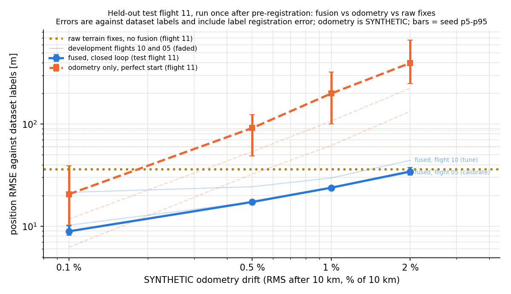
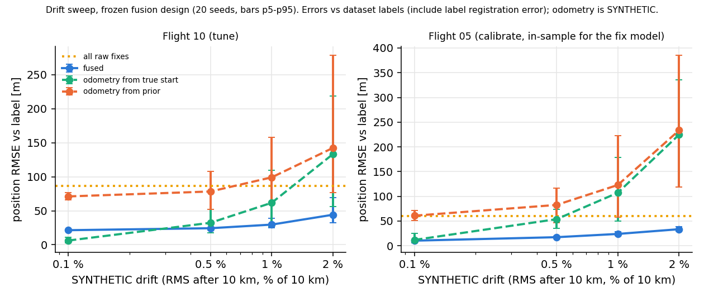
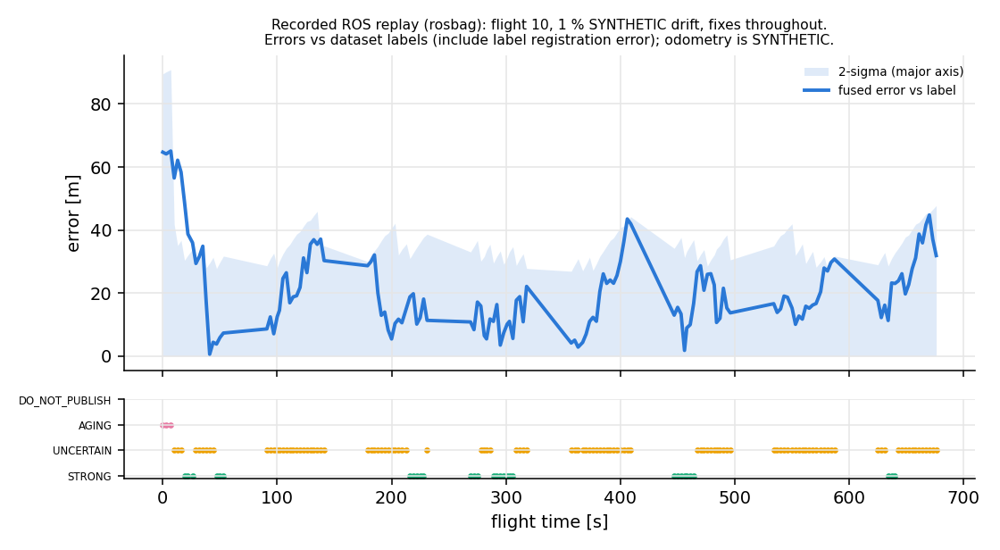
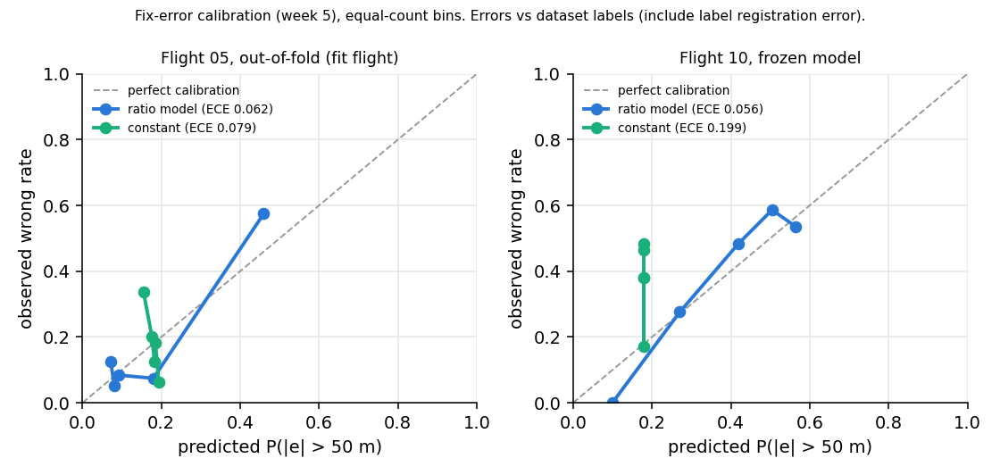

# trn-belief: terrain-relative navigation with calibrated confidence

**What this is.** A navigation pipeline that estimates a drone's position from downward-looking aerial images and a
satellite map, fuses it with odometry, and publishes the position **together with an honest uncertainty and a
validity state**. It refuses to publish a position it cannot back up. It is a portfolio project, built in
simulation and on public recorded data. **No real drone was flown, and nothing here is flight-ready.**

**Headline result (flight 11, the held-out test flight, run once after pre-registration):** see
[Results](#results). Every error in this repository is measured against the dataset's GPS labels. Those labels are
themselves 10–40 m off the map in places, so every number includes that label registration error.



## About this repository

This is a public copy with a fresh history. **The full development history is kept in a private repository because
of the dataset licence**: UAV-VisLoc may not be redistributed, and the working repository holds files with positions
derived from its labels. I can walk through the work, including the private history, on request.

What this copy contains and leaves out:
- **Contains:**
  - all code, tests and launch files;
  - the plain-language development log (`docs/log.md`);
  - the pre-registration, test results and freeze list;
  - aggregated result tables and figures;
  - the working instructions used to direct the development (`docs/process/`).
- **Left out:**
  - every file with label-derived positions (listed in `docs/private_files.md`);
  - per-frame and per-pose result files;
  - run logs, a binary project-plan document, and all imagery, map chips, overlays, rosbags and caches (never
    committed even privately).
- **Edited:**
  - 8 coordinate values in `docs/log.md` are replaced by "[coordinate removed]";
  - `eval/splits.json` keeps its regions, flights and splits but not its coordinates.
- **Tags:** the tags mentioned in the docs (`pre-test`, `test-runner`, `test-results`) exist only in the private
  history.
- **Check:** `python3 eval/scan_public.py .` fails on any position column, coordinate key, coordinate-like number,
  image, recording or cache. It passes on this copy.

## The problem

Without GPS, a drone's own odometry (visual-inertial or similar) drifts: the error grows with distance flown. A camera
looking down can recognise the ground against a stored satellite map and give an absolute position fix. But such a
fix is sometimes plainly wrong: repetitive fields, haze, an old map, changed buildings. The hard part is not getting a
position. It is **knowing when to trust it**, and telling the rest of the system how much.

## How it works, stage by stage

| Stage | What it does | Why | Code |
|---|---|---|---|
| 1. Drift model | Measures how a real visual-inertial odometry (OpenVINS) drifts on the indoor TUM VI dataset, and fits error-vs-distance models | Gives the drift *form* used for the synthetic odometry | `eval/fit_drift_model.py` → `eval/results/vio/drift_params.json` |
| 2. Map side and data | Indexes UAV-VisLoc, assembles map patches from the satellite chips (georeferenced, local ENU frame), loads image + label + a noisy prior | Everything downstream needs map patches and labels in metres | `src/trn_matcher/trn_matcher/{tile_store,loader,geo}.py` |
| 3. Terrain matcher | Slides the aerial image over the map (normalised cross-correlation of contrast-normalised images, with masks for missing map and rotated corners), over sizes 0.8–1.3× and rotations ±20°, coarse to fine | Turns one image into a position candidate plus diagnostics (peak, peak ratio, overlap, top-3 candidates) | `src/trn_matcher/trn_matcher/matcher.py`, settings frozen in `matcher_frozen.json` |
| 4. Calibration | Models each fix's error as "probably right (Gaussian, about 21 m per axis) or wrong (broad, about 100 m)", with the chance of being wrong predicted from the peak ratio | Gives every fix a probability of being wrong and an honest spread | `src/trn_calibration/trn_calibration/covariance.py`, `calibration_frozen.json` |
| 5. Fusion | GTSAM iSAM2 over 2-D positions: synthetic odometry between frames; fixes as robust two-component (max-mixture) factors, thinned to one per 9 s, gated by a mixture p-value, covariance inflated 1.2× | Combines drifting odometry with occasionally wrong fixes | `src/trn_fusion/trn_fusion/core.py`, `fusion_frozen.json` |
| 6. Belief and validity | Publishes `NavBelief` (position, covariance, time since last fused fix, state STRONG / AGING / UNCERTAIN / DO_NOT_PUBLISH, reason) | Consumers must check the state before using the position | `src/trn_fusion/trn_fusion/{validity,belief_node}.py`, `src/trn_msgs/msg/NavBelief.msg` |
| 7. Consumer | A planner stub: normal / flag degraded / request a fix and slow / hold the last good state and ask for a fallback | Shows what "refuse to publish" means for the rest of the system (software only) | `src/trn_consumer/trn_consumer/policy.py` |

The full reasoning, every command and every number are in `docs/log.md`, in plain language. The matcher and the error
model each have a step-by-step explanation there.

## Data: where to get it, licences

No dataset files are in this repository. Download them yourself, under their licences:

| Dataset | Used for | Where | Licence |
|---|---|---|---|
| TUM VI (visual-inertial benchmark) | fitting the drift *form* (week 2: OpenVINS on room1/room2, 512_16 calibrated bags) | https://cvg.cit.tum.de/data/datasets/visual-inertial-dataset (files under https://vision.in.tum.de/tumvi/calibrated/512_16/) | CC BY 4.0; cite Schubert, Goll, Demmel, Usenko, Stückler, Cremers, "The TUM VI Benchmark for Evaluating Visual-Inertial Odometry", IROS 2018 |
| UAV-VisLoc v1.0 | aerial images, GPS labels, satellite map chips (flights 05, 10, 11; 18–20 thermal, excluded) | Zenodo record 19603534, DOI 10.5281/zenodo.19603534, https://zenodo.org/records/19603534 | no licence selected on the record; the satellite chips come from Google Earth Pro and fall under Google Earth / Maps and third-party imagery terms |

- **UAV-VisLoc is used here for academic research only, and is not redistributed in any form.** That covers no
  images, map chips, overlays or samples, and no file of label-derived positions. Cite the dataset authors and
  attribute Google Earth.
- `data/README.md` has sizes, MD5 sums and the download commands; `eval/visloc_download.py` downloads the UAV-VisLoc
  flights used here.
- `eval/splits.json` has no coordinates here. Regenerate the full file (region origins) after download with
  `python3 eval/make_splits.py`. Scripts and tests that read per-frame results or region origins only run after the
  data is downloaded and the pipeline re-run; until then the real-data tests skip.

## Data and its caveats

- **TUM VI (indoor, handheld)** was used only to fit the *form* of the odometry drift: a white floor plus a random walk.
  It is indoor, short (< 150 m) and not flight data. The drift *levels* in the experiments (0.1–2 % of distance) are
  a sweep, not a measurement.
- **UAV-VisLoc** (Zenodo record 19603534; academic use only, **no redistribution**) provides the aerial images, the GPS
  labels and the satellite map chips (Google Earth imagery).
  - Three regions, split by whole flights, more than 10 km apart:
    - flight 10, Hebei farmland: **tune**;
    - flight 05, Yunnan mountains: **calibrate**;
    - flight 11, Gansu, arid: **test**, used once.
  - **Flights 18–20 (Jiangsu) are thermal infrared.** That was found from the overlays; the metadata does not say it.
    They are excluded from all splits.
- **Label registration error.** The dataset's GPS labels and the satellite map disagree by 10–40 m in places.
  - On flight 10 the matched position sits about 20 m *ahead* of the label along the flight direction (a timing
    lag of about 0.9 s fits it), plus about 8 m sideways.
  - On flight 05 a lag explains almost nothing (0.3 s, 25 m of unexplained scatter).
  - The two lags disagree, so no lag correction is applied anywhere.
  - Consequences: every error includes this, errors below about 15 m cannot be told apart from it, and the reported
    uncertainty is uncertainty about the *label*, not about the true position.
- **What is published.** No images, map chips, overlays or label-derived positions; see "About this repository".

## Results

The test flight (flight 11, arid Gansu, 590 frames over 81 min) was run **once**, after the tables and predictions
had been pre-registered (`docs/test_preregistration.md`, tagged `pre-test` in the private history). The filled
tables are in
`docs/test_results.md`. The run was resumed once after an infrastructure shutdown; no run was repeated.

**Headline (closed loop: the matcher searches around the fused estimate; 5 seeds per drift level).** Errors are
against dataset labels (including label registration error); odometry is SYNTHETIC.

| Drift (RMS, % of 10 km) | Fused RMSE (median) | Perfect-start odometry RMSE | Raw fixes RMSE (median) | NEES (2 = consistent) | Inside 95 % ellipse | Track lost |
|---|---|---|---|---|---|---|
| 0.1 % | 8.9 m (7.0) | 20.5 m | 36.0 m (26.7) | 2.13 | 0.94 | 0/5 |
| 0.5 % | 17.3 m (14.3) | 91.5 m | 36.0 m (26.7) | 1.92 | 0.96 | 0/5 |
| 1 % | 23.8 m (19.0) | 199.2 m | 36.0 m (26.7) | 1.90 | 0.95 | 0/5 |
| 2 % | 34.3 m (26.4) | 396.2 m | 36.0 m (26.7) | 1.93 | 0.95 | 0/5 |

**Read these three caveats with the table.**
1. **Calibrated on average, weak per fix.** The fix model's probabilities are right on average on flight 11 (ECE
   0.035; accepted fixes wrong 8.6 % vs a predicted 9.9 %). But the peak ratio is weak at telling *which*
   individual fix is wrong: AUC 0.60, where 0.5 is chance and the development flights reached 0.74–0.76.
2. **The 0.1 % win depends on flight 11's labels.**
   - Fusion beat perfect-start odometry at 0.1 % drift on this flight (8.9 vs 20.5 m), but lost on the tune flight
     (21.4 vs 6.2 m). The difference is the labels, not the method: flight 11's fix errors share only a small
     common offset (median about 2 m in an exploratory, post-test diagnostic), so averaging many fixes works.
   - A direction-dependent offset like the tune flight's was not checked on flight 11.
3. **"Refuse to publish" was not exercised on the test flight.** The belief never reached DO_NOT_PUBLISH on flight 11,
   because fixes kept coming. Refusal was only tested in the development outage replays (weeks 6–7), not on the test
   flight.

At 2 % drift the fused error (34.3 m) is close to the raw fixes' (36.0 m): fusion still wins clearly over odometry,
but adds little over the fixes alone at that level.

- **Validity.** The belief was STRONG on about 87 % of frames and UNCERTAIN on about 12 %. Fused errors over 50 m:
  0–8 % of STRONG frames, up to 58 % of the few AGING frames at 2 % drift.
- **Fix calibration.** Coverage 0.53 / 0.92 / 0.95 at 50 / 90 / 95 %, against nominal; sharpness (median 90 % radius)
  50 m.
- **Predictions: three of four failed, all in the system's favour.**
  - P1: we predicted an overconfident belief (NEES > 2); measured 1.97.
  - P2: we predicted more wrong fixes than promised; measured 0.086 vs 0.099.
  - P3a: we predicted no gain over perfect-start odometry at 0.1 % drift; fusion won, 8.9 vs 20.5 m.
  - P3b held: fusion wins from 0.5 % drift.
  - As written before the run, this is one flight. Its shared label offset is small (see caveat 2). This does not
    generalise to flights like the tune flight, whose labels carry a direction-dependent offset of about 20 m.
- **Development flights, for context** (frozen design, open loop, 20 seeds):
  - Tune flight 10: fused RMSE 21.4–44.2 m; it loses to perfect-start odometry at 0.1 %; NEES 2.6–4.7
    (overconfident).
  - Calibrate flight 05: fused RMSE 10.2–33.4 m; NEES about 2, but that flight is in-sample for the calibration.


## Open questions

- **Does flight 11's label offset flip with flight direction?** Not checked. The exploratory post-test diagnostic
  found a small *shared* offset (median about 2 m), but a single median over both flight directions would cancel an
  offset that reverses with direction, as on the tune flight (about 20 m along track). The by-direction diagnostic
  refuses the test split by design, so it was not run. If the offset does flip, caveat 2 understates how much flight
  11's labels shape its result.

## Figures

- `docs/figures/drift_sweep.png`: position error vs synthetic drift level, tune and calibrate flights (fused vs odometry
  vs raw fixes).
- `docs/figures/validity_timeline.png`: a recorded ROS replay (rosbag): fused error, 2-sigma band, validity state.
- `docs/figures/calibration_reliability.png`: predicted vs observed probability that a fix is wrong.





## Limitations (read before trusting any number)

1. **Synthetic odometry.**
   - The odometry is the label path plus sampled drift; no real visual-inertial odometry was flown with the aerial
     images.
   - The filter was told the exact drift statistics. Week 7 shows that under-estimating drift makes the belief
     overconfident (NEES 4–8); over-estimating is safe.
2. **No recovery path.**
   - Once the belief is confidently wrong, the gate rejects every later fix and nothing re-initialises it.
   - This was seen in a ROS replay where the belief node started from a stale position: it fused 0 of 126 fixes.
     That cause is fixed, but a general recovery (re-localisation over a wider window) does not exist.
3. **Closed loop during a fix outage is untested.**
   - The closed loop (matcher searching around the fused estimate) was tested only while fixes kept coming. Then the
     window stayed at its 150 m floor.
   - During an outage the window would grow beyond the ±150 m the calibration was fitted with. That case was never
     run.
4. **A single calibration flight.**
   - The fix-error model, the validity cuts and the fusion inflation were all fitted on flight 05. Flight 05 is
     therefore in-sample for all of them.
   - On flight 10 the fused covariance stayed overconfident (NEES about 3.3); on test flight 11 it was consistent
     (NEES about 2).
5. **Label offset and lag.** See "Data and its caveats".
   - The labels are offset along the track by an amount that differs between flights (lag −0.9 s vs −0.3 s), so the
     error floor is about 15–25 m whatever the matcher does.
   - No bias state is estimated; that was a rule.
6. **Matcher speed.** About 7.5 s per frame single-threaded on flight 10, and about 45 s per frame on the larger-footprint
   flights 05 and 11 when 14 run in parallel. Fine for replay; far from real time.
7. **Decisions made after seeing results.** All are logged in `docs/log.md`. They concern flights 10 and 05, never 11:
   - matcher: Fisher-z candidate ranking, after the first run favoured small templates;
   - matcher: rotation search widened from ±5° to ±20°, after a sweep;
   - calibration: the model-choice rule changed from an unpaired to a paired standard error, after its first run;
   - calibration: a shift-robust comparison model added after the first run;
   - validity: STRONG cut (P(wrong) ≤ 0.15) set after the flight 10 curve had been seen;
   - fusion: a 2 % drift outage scenario added after the 1 % one never reached DO_NOT_PUBLISH.
8. **Odometry versus fixes.** At very low drift (0.1 %), fusion is worse than perfect-start odometry on the tune
   flight (10), because the fixes' label-referenced error is larger than the drift. On the test flight (11) it was
   better (8.9 vs 20.5 m), because that flight's labels carry little systematic offset. Whether fusion helps at low
   drift depends on the labels as much as on the method.
9. **One test flight.** All test conclusions rest on one 81-minute flight in one arid region. Three of the four
   predictions failed in the system's favour. That is a result about this flight, not a demonstration of
   generality.

## How to run

```bash
source /opt/ros/jazzy/setup.bash && colcon build --symlink-install && source install/setup.bash
# replay a flight through the fusion and the consumer (SYNTHETIC odometry; flight 11 is refused)
ros2 launch launch/replay.launch.py flight:=10 drift_pct:=1.0 seed:=0 speed:=20.0
```

- Matcher and calibration scripts run with `/usr/bin/python3` (OpenCV 4.6). Fusion needs GTSAM, which only the venv
  `~/venvs/trn` has. `eval/envcheck.py` refuses mismatched environments.
- Datasets live in `~/data/` and are never committed. `data/README.md` says how to download them.
- The single test run was made with `eval/run_test.py`. In this copy it refuses to run, as designed: it requires the
  `pre-test` tag and the frozen-file hashes of the private history, and it refuses a second run.

## Licence

The code and documentation in this repository are under the MIT licence (`LICENSE`). The licence does not cover
the datasets: TUM VI is CC BY 4.0, and UAV-VisLoc and its Google Earth imagery are under their own terms (see
"Data: where to get it, licences"). No dataset files are included here.
